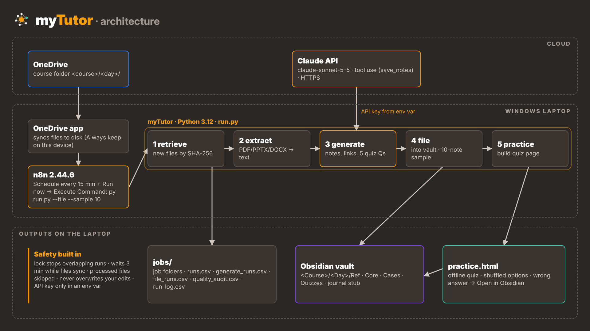

<p align="center"></p>

# myTutor: from lecture file to second brain

myTutor turns the course files you save into OneDrive (lecture slides, readings, cases) into
**linked Obsidian notes and an offline practice quiz**, automatically. n8n checks the folder every
15 minutes and runs a small Python pipeline that calls the Claude API.

Built by Naw Aung (81017125) for the MBAM601 *Digital Experiment: Build, Measure, Learn*,
UC Executive MBA, October 2026.

| | |
|---|---|
| **Final deck (9 slides, PDF)** | [docs/deck/myTutor_Final_Deck_9_slides.pdf](docs/deck/myTutor_Final_Deck_9_slides.pdf) |
| **Final deck (PowerPoint)** | [docs/deck/MyTutor Demo version 3.3.pptx](<docs/deck/MyTutor Demo version 3.3.pptx>): same 9 slides with speaker notes and clickable GitHub links |
| **Full working deck (18 slides, PDF)** | [docs/deck/myTutor_Full_Working_Deck_18_slides.pdf](docs/deck/myTutor_Full_Working_Deck_18_slides.pdf). Earlier draft kept for detail; where numbers differ, the 9-slide deck is final |
| **Developer guide (PDF)** | [docs/guides/myTutor_Developer_Guide.pdf](docs/guides/myTutor_Developer_Guide.pdf): architecture, prerequisites, versions, setup, config, troubleshooting |
| **Key prompts** | [docs/prompts/PROMPTS.md](docs/prompts/PROMPTS.md): the manual baseline prompt and myTutor's system prompt |
| **Manual test workbook** | [Blank template](docs/manual-test/myTutor_Manual_Test_Template.xlsx) and [Day 9 results](docs/manual-test/myTutor_Manual_Test_Day9_results.xlsx) |
| **Accuracy audit (Day 9 sample, AI-assisted)** | [docs/evidence/myTutor_accuracy_audit_Day9.csv](docs/evidence/myTutor_accuracy_audit_Day9.csv) |
| **Accuracy re-audit (Day 10, manual self-audit)** | [docs/evidence/myTutor_evidence_workbook.xlsx](docs/evidence/myTutor_evidence_workbook.xlsx) (tab 1): 30 of 30 claims supported across 8 notes, each with a page reference; 2 classmates blind-checked 10 random claims and agreed on all 10 |
| **Fresh-file timing replication (1 Nov)** | [docs/evidence/myTutor_evidence_workbook.xlsx](docs/evidence/myTutor_evidence_workbook.xlsx) (tab 2): 4 unseen files, each done one way only: 3.68 vs 1.11 min per 1,000 words, 70% less |

## Results in one line

On the same five Day 9 files: **44.5 min by hand → 12.3 min with myTutor, full run plus review (−72%)**, 3.6 vs 2.2 links
to existing notes per note, 34 of 34 notes passing five structural checks (manual: 21 of 30),
US$0.48 of API cost. Accuracy: 31 of 32 statements (Day 9, AI-assisted) and 30 of 30 claims in a manual self-audit (Day 10). Recall: 17/20 on the Day 9 quiz from memory, six days later. Replicated on 4 unseen files: 70% less time per 1,000 words. One tester, self-timed; see the deck for method and limits.


## Repository layout

```
mytutor/
├── run.py  retrieve.py  extract.py  generate.py  file.py  practice.py  jobs.py   pipeline
├── config.example.json          copy to config.json (never committed)
├── requirements.txt
├── n8n_mytutor_workflow.json    import into n8n
├── start-n8n.bat  run_mytutor.bat
├── tests/                       63 unit tests
└── docs/
    ├── guides/        Developer Guide (PDF), retrieve details
    ├── architecture/  architecture diagram
    ├── prompts/       manual baseline prompt + myTutor system prompt
    ├── manual-test/   test workbook: blank template + Day 9 results
    ├── deck/          final 9-slide deck + 18-slide working deck (PDF)
    ├── evidence/      accuracy audit, answer-shuffle retest
    └── assets/        logo
```

## How it works



```
OneDrive  <course>/<day>/  ─►  n8n (every 15 min)  ─►  run.py
                                                         1 retrieve.py   copy new files into a dated job folder
                                                         2 extract.py    PDF / PPTX / DOCX → clean text
                                                         3 generate.py   Claude API: notes, links, 5 quiz questions per source
                                                         4 file.py       file into the Obsidian vault, never over your edits;
                                                                         pick a 10-note spot-check sample
                                                         5 practice.py   rebuild the offline practice page
```

Every step writes a log (`jobs/runs.csv`, `generate_runs.csv`, `file_runs.csv`, `quality_audit.csv`,
`run_log.csv`), which is where the KPIs come from. Files already processed are recorded by
checksum, so nothing is sent to Claude twice.

## Setup guide (Windows)

### 1. Install what it needs
1. **Python 3.11+** from python.org (tick *Add to PATH*). Check: `py --version`
2. **Node.js 24+** from nodejs.org (n8n 2.x needs it). Check: `node -v`
3. **n8n:** `npm install -g n8n`
4. **Obsidian** from obsidian.md, with a vault for your notes.
5. **OneDrive app**, signed in, so your course folder syncs to your PC.

### 2. Get the code
```
cd /d %USERPROFILE%
git clone https://github.com/henrynawaung/mytutor.git
cd mytutor
py -m venv .venv
.venv\Scripts\python -m pip install -r requirements.txt
.venv\Scripts\python -m unittest discover tests      (should end with OK)
```
The virtual environment (`.venv`) keeps myTutor's libraries in its own folder, at the pinned versions.
Wherever a later command says `py`, use `.venv\Scripts\python` instead, including in the n8n command.

Verified on Windows on 1 Nov 2026: a fresh clone of v3.3 in a new folder, set up exactly as above, ran 63 of 63 tests OK.

### 3. Add your Claude API key (never in a file)
```
setx ANTHROPIC_API_KEY "your-key-here"
```
Close and reopen Command Prompt. The key lives only in your Windows environment, and
`.gitignore` blocks `config.json`, `key.txt` and `.env` so they cannot be committed by mistake.
Set a monthly spending limit in the Anthropic console.

### 4. Make your config
Copy `config.example.json` to `config.json` and set:

| Setting | Example | Meaning |
|---|---|---|
| `synced_inbox` | `~/OneDrive/MyTutor` | Folder holding `<course>/<day>/` sub-folders, e.g. `MBAM601_.../Day 9/` |
| `jobs_root` | `~/mytutor/jobs` | Where job folders, logs and `practice.html` go |
| `vault_path` | `C:/Users/<you>/Documents/MBA Vault` | Your Obsidian vault |
| `obsidian_vault_name` | `my_vault` | Used for "Open in Obsidian" links |
| `model` | `claude-sonnet-5-5` | Claude model for note writing |

In OneDrive, right-click the course folder → **Always keep on this device**, so files are on
disk, not cloud-only.

### 5. Try one run by hand
```
py run.py --dry-run                    which day folders would be processed
py run.py --file --sample 10           process them, file into Obsidian, pick a sample
py practice.py --open                  open the practice page
```

### 6. Automate with n8n
1. Double-click **`start-n8n.bat`** (it sets `NODES_EXCLUDE=[]`, because n8n 2.x disables the
   Execute Command node by default). Wait for *Editor is now accessible via http://localhost:5678*.
2. In n8n: **Add workflow → ⋯ → Import from file →** `n8n_mytutor_workflow.json`.
3. The **Run myTutor** node runs `cd /d %USERPROFILE%\mytutor && py run.py --file --sample 10`;
   change the path if your folder is elsewhere.
4. Click **Execute workflow** once to test, then **Publish** so the 15-minute schedule runs.
5. Fall-back: Windows **Task Scheduler** can run `run_mytutor.bat` on the same schedule.

The laptop must be on and OneDrive synced for scheduled runs.

## Everyday use
- Save course files into `<course>/<day>/` in OneDrive. That's it.
- Spot-check the 10 sampled notes listed in `jobs/quality_audit.csv`.
- Practise with `jobs/practice.html`; a wrong answer opens the source note in Obsidian.
- Files added to a day later: run `py generate.py --day "Day N" --rebuild-set` and
  `py practice.py` so the day's quiz includes them.

## Useful commands
| Command | What it does |
|---|---|
| `py generate.py --day "Day 9" --estimate` | Token and cost estimate only |
| `py generate.py --day "Day 9" --only "Kowhai" --force` | Redo one source |
| `py file.py --day "Day 9" --dry-run` | Show what filing would change |
| `py file.py --day "Day 9" --sample 10 --no-file` | Pick a new spot-check sample only |

## Limits and responsible use
- Course files are sent to an AI service: process only material you are licensed to use and
  follow your university's guidance on AI tools. Course files themselves are **not** in this repo.
- Scanned PDFs need OCR, which is not built yet.
- Notes pass structural checks automatically; factual accuracy needs a human spot-check.

More detail on the retrieve step: [docs/guides/retrieve-details.md](docs/guides/retrieve-details.md).
